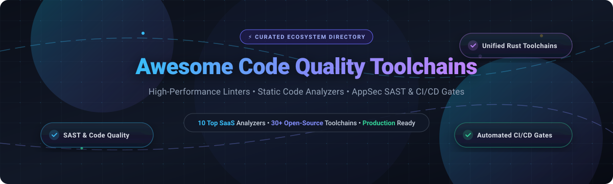

# ⚡ Awesome Code Quality Toolchains 🛠️

**A Curated Directory of Next-Gen Code Quality Platforms, Static Analyzers, Fast Linters & Automated CI/CD Quality Gates**

*Empowering engineering teams with lightning-fast code analysis, automated vulnerability prevention, and modern compiler toolchains.*

**Last updated: October 2026** 📅

---

## 📖 Table of Contents

- [🌐 Sector Overview & Market Dynamics](#-sector-overview--market-dynamics)
- [🏢 SaaS & Hosted Platforms](#-saas--hosted-platforms)
- [🚀 Open-Source GitHub Projects](#-open-source-github-projects)
  - [⭐ Tier-1 Ecosystem Flagships](#-tier-1-ecosystem-flagships)
  - [🧰 Additional Strong Open-Source Options](#-additional-strong-open-source-options)
- [📈 Star History](#-star-history)
- [💖 Support & Sponsorship](#-support--sponsorship)
- [🤝 How to Contribute](#-how-to-contribute)
- [⚖️ Disclaimer](#️-disclaimer)

---

## 🌐 Sector Overview & Market Dynamics

The global **Static Application Security Testing (SAST) and automated code quality tools** market is valued at approximately **$680 million in 2026** (scaling within the broader **$12.6 billion Application Security Testing (AST)** ecosystem at an ~18–22% CAGR). The sector is **moderately fragmented**: enterprise heavyweights (Synopsys/Black Duck, Checkmarx, Veracode, and Microsoft/GitHub) anchor ~35% of regulated enterprise demand, while high-velocity developer-first innovators and unified Rust-based toolchain disruptors (Snyk, SonarSource, Biome, Astral/Ruff) capture high-growth continuous integration adoption across modern cloud-native codebases.

---

## 🏢 SaaS & Hosted Platforms

| Product | Company Scale (Valuation / Revenue) | Pricing (Starting Tier) | Free Tier Limits (or Trial Details) | Key Capabilities & Highlights |
| :--- | :--- | :--- | :--- | :--- |
| **[GitHub Advanced Security](https://github.com/features/security)** | **$3.1T+ Market Cap** (Microsoft parent) / **$1B+ ARR** (GitHub) | **$19/committer/mo** (Secret Protection), **$30/committer/mo** (Code Security), or **$49/committer/mo** (Full Suite) | **100% Free forever for all public repositories** with unlimited scans and users; no free tier allowance for private repositories (requires enterprise license). | Built-in semantic code analysis via CodeQL, AI-assisted Copilot Autofix, push protection against leaked credentials, and automated Dependabot alerts directly in GitHub PRs. |
| **[Coverity (Black Duck / Synopsys)](https://www.synopsys.com/software-integrity/security-testing/static-analysis-sast.html)** | **~$2.1B Acquisition Valuation** / **~$400M+ Annual Rev** (Black Duck / Software Integrity Group) | **~$800–$1,500/developer/year** (custom annual contract; entry suites start ~$15,000–$25,000+/year) | **No self-serve free trial for commercial tier**; offers sales-guided custom POC (typically 14–30 days on sample codebase). Completely free separate **Coverity Scan** service for open-source projects. | Enterprise-grade static analysis with deep interprocedural defect and vulnerability detection across C/C++, Java, C#, and safety-critical aerospace and automotive embedded systems. |
| **[Snyk Code](https://snyk.io/product/snyk-code/)** | **$7.4B Peak Valuation** / **~$320M+ ARR** | **$25/developer/month** (Team plan, billed monthly or annually) | **Free forever plan**: Capped at **100 Snyk Code (SAST) tests/month**, 200 SCA scans/month, and 300 IaC scans/month for unlimited contributing developers. | AI-native static application security testing (SAST) providing sub-second IDE feedback, automated fix suggestions, and unified coverage across code, dependencies, and containers. |
| **[SonarQube / SonarCloud](https://www.sonarsource.com/products/sonarqube/)** | **$4.7B Valuation** / **~$200M+ ARR** | **$34/month** (Team plan, covers up to 100,000 Lines of Code) | **Free forever plan**: Unlimited scans for up to **50,000 Lines of Code (LOC)** and up to 5 members for private repositories; **100% free with unlimited LOC** for public open-source projects. | Continuous code inspection covering 30+ programming languages, automated quality gate status checks, code smell metrics, test coverage tracking, and compliance enforcement. |
| **[Veracode](https://www.veracode.com/)** | **$2.5B Valuation** / **~$250M+ ARR** | **~$15,000/year** (Starting SAST application tier; SCA starts ~$12,000/year) | **14-day free trial** for specific modules (e.g. Dynamic Analysis or Security Labs); core SAST requires sales-coordinated Proof-of-Concept (POC) with restricted duration and application volume. | Comprehensive application security testing platform combining SAST, DAST, SCA, container scanning, and remediation guidance built for enterprise compliance standards. |
| **[Checkmarx](https://checkmarx.com/)** | **$1.1B Valuation** / **~$250M+ ARR** | **~$800–$2,000/developer/year** (Annual subscription; entry configurations start in high five-figures) | **No public self-serve free trial**; access provided exclusively through sales-coordinated guided Proof-of-Concept (POC) runs tailored to target code repositories. | Unified cloud-native application security platform integrating SAST, SCA, Infrastructure-as-Code (KICS) validation, and API security auditing with enterprise governance. |
| **[Qodana (JetBrains)](https://www.jetbrains.com/qodana/)** | **~$450M Annual Revenue** (JetBrains parent) | **$5–$6/active contributor/month** (Ultimate plan, min. 3 contributors; billed annually) | **Free forever (Community Edition)**: Unlimited lines of code and tests for JVM, Python, .NET, and C/C++; JavaScript, TypeScript, Go, and PHP analysis require paid tier. | JetBrains-native code quality platform running IDE-level inspections directly in CI/CD pipelines with actionable code fragments, regression detection, and quality gates. |
| **[Codacy](https://www.codacy.com/)** | **~$10M–$15M ARR** (Funded by Armilar, Seedcamp) | **$18/developer/month** (Team plan billed annually) or **$21/developer/month** (monthly) | **Free forever (Developer Plan)**: Real-time feedback, IDE plugins, and quality checks for solo developers; 100% free for open-source repositories; 14-day free trial on Team tier. | Automated code review and static analysis across 40+ languages with cyclomatic complexity monitoring, duplication checks, and granular pull request quality gates. |
| **[DeepSource](https://deepsource.com/)** | **~$5M–$8M ARR** (Backed by 645 Ventures, Y Combinator) | **$24/user/month** (Team plan billed annually) or **$30/user/month** (monthly) | **Free forever (Individual Plan)**: Up to **3 private repositories** for solo developers; free for public open-source repositories (capped at 1,000 PR runs/month); 14-day Team trial. | Developer-centric automated code review with continuous security scanning, automated Autofix pull requests, zero configuration setup, and coverage reporting. |
| **[Code Climate (Qlty Software)](https://qlty.sh/)** | **~$5M–$10M ARR** (Spun off Quality product as Qlty) | **$20/contributor/month** (Pro plan, billed monthly or annually) | **Free forever plan**: Unlimited private/public contributors capped at **1,000 analysis minutes/month** and **100 AI autofixes/month**; 100% free for public open-source repos. | Automated code maintainability grading, technical debt calculation, structural duplication identification, and automated PR review checks. |

---

## 🚀 Open-Source GitHub Projects

All open-source tools listed below are ranked strictly by **GitHub Stargazers Count (descending)**. Every project features a direct stargazer badge linking to its stargazer community.

### ⭐ Tier-1 Ecosystem Flagships

- **[Prettier](https://github.com/prettier/prettier)**   
  *Opinionated code formatter for JavaScript, TypeScript, HTML, CSS, Markdown, and JSON (MIT).*  
  The world’s most adopted code formatting engine—relied upon by millions of developers to eliminate stylistic debates by parsing code into ASTs and re-printing it with strict formatting rules.

- **[Ruff](https://github.com/astral-sh/ruff)**   
  *Extremely fast Python linter and code formatter written in Rust (MIT).*  
  Over 10–100x faster than traditional tools like Flake8, Black, and isort. Replaces an entire ecosystem of individual Python plugins with a single zero-dependency binary implementing 900+ lint rules.

- **[ShellCheck](https://github.com/koalaman/shellcheck)**   
  *Static analysis tool for sh/bash shell scripts written in Haskell (GPL-3.0).*  
  The de facto quality gate for shell scripting. Identifies syntax errors, insidious corner-case bugs, quoting issues, and semantic hazards before scripts run in production pipelines.

- **[Trivy](https://github.com/aquasecurity/trivy)**   
  *All-in-one security scanner for vulnerabilities, secrets, and misconfigurations (Apache-2.0).*  
  Rapid comprehensive vulnerability scanner supporting container images, file systems, Git repositories, virtual machine disks, and Kubernetes manifests with SBOM generation.

- **[Gitleaks](https://github.com/gitleaks/gitleaks)**   
  *Fast, lightweight secret scanner for detecting hardcoded API keys and credentials (MIT).*  
  The gold standard for credential leak prevention. Scans commits, branch history, and local staging areas with custom regex and Shannon entropy checks to stop security leaks before commit push.

- **[ESLint](https://github.com/eslint/eslint)**   
  *Pluggable and configurable JavaScript & TypeScript static code analysis engine (MIT).*  
  The core standard for JavaScript ecosystem code quality. Identifies problematic coding patterns, enforces functional and stylistic constraints, and powers automated fixes across modern web runtimes.

- **[Biome](https://github.com/biomejs/biome)**   
  *High-performance unified toolchain for web projects written in Rust (MIT).*  
  Formats and lints JavaScript, TypeScript, JSX, and JSON up to 35x faster than Prettier. Provides 97% Prettier compatibility, instant single-command migrations, and first-class IDE integrations.

- **[Oxc](https://github.com/oxc-project/oxc)**   
  *Suite of high-performance compiler tools and linter for JavaScript/TypeScript written in Rust (MIT).*  
  The ultra-fast "Oxidation Compiler" toolkit featuring an extraordinarily fast linter (50–100x faster than ESLint), parser, AST transformer, and resolver engineered for web developer toolchains.

- **[golangci-lint](https://github.com/golangci/golangci-lint)**   
  *Fast, parallel Go linters runner with smart caching (GPL-3.0).*  
  The industry-standard Go quality runner. Integrates over 100 specialized Go linters in parallel, shares Go AST representations to slash memory, and caches previous analysis runs for CI speed.

- **[Semgrep](https://github.com/semgrep/semgrep)**   
  *Lightweight semantic static analysis for searching code and enforcing standards (LGPL-2.1).*  
  Enables developers to write custom AST-aware queries that look like ordinary code. Scans 30+ languages in seconds, backed by a massive community registry of vulnerability and hygiene rules.

- **[Infer](https://github.com/facebook/infer)**   
  *Static analyzer for Java, C, C++, and Objective-C by Meta (MIT).*  
  Uses separation logic and bi-abduction to prove mathematical program properties, spotting complex null pointer dereferences, resource leaks, memory corruptions, and concurrency race conditions.

- **[Pre-commit](https://github.com/pre-commit/pre-commit)**   
  *Multi-language framework for managing and maintaining pre-commit git hooks (MIT).*  
  Standardizes developer workstations across organizations by automatically downloading, configuring, and executing linters, formatters, and hygiene checks before commits are finalized.

- **[PHPStan](https://github.com/phpstan/phpstan)**   
  *Static analysis tool for PHP focusing on finding bugs without writing tests (MIT).*  
  Scans entire PHP codebases to catch type mismatches, dead code, undefined methods, and incorrect logic checks through graduated strictness levels from 0 to 9.

- **[Clippy](https://github.com/rust-lang/rust-clippy)**   
  *Collection of lints to catch common mistakes and improve Rust code (Apache-2.0/MIT).*  
  The official Rust compiler linter. Bundles over 700 checks covering correctness, idiomatic style, performance bottlenecks, and unnecessary allocations with precise compiler diagnostics.

- **[RuboCop](https://github.com/rubocop/rubocop)**   
  *Ruby static code analyzer and code formatter based on the community Ruby Style Guide (MIT).*  
  The authoritative linter for Ruby and Ruby on Rails. Enforces standard conventions, catches runtime pitfalls, and features automated safe code correction.

- **[Hadolint](https://github.com/hadolint/hadolint)**   
  *Smarter Dockerfile linter that helps build best practice container images (GPL-3.0).*  
  Parses Dockerfile ASTs and runs ShellCheck on inner RUN instructions to ensure minimal image footprints, secure user definitions, and proper caching layers.

- **[SonarQube Community Edition](https://github.com/SonarSource/sonarqube)**   
  *Self-hosted open-source continuous inspection platform (LGPL-3.0).*  
  The community edition of SonarQube analyzing 19+ languages out-of-the-box, providing centralized dashboards for technical debt, duplication, coverage, and security hotspots.

- **[CodeQL](https://github.com/github/codeql)**   
  *Declarative, object-oriented query language to treat code as data (MIT repo queries).*  
  The semantic engine powering GitHub Advanced Security. Builds relational representations of codebases to track taint-flow paths and uncover critical vulnerabilities like SQLi and RCE.

### 🧰 Additional Strong Open-Source Options

- **[Checkstyle](https://github.com/checkstyle/checkstyle)**  — Development tool to help programmers write Java code that adheres to a coding standard (LGPL-2.1).
- **[gosec](https://github.com/securego/gosec)**  — Security checker inspecting Go ASTs to identify security flaws and injection vulnerabilities (Apache-2.0).
- **[Bandit](https://github.com/PyCQA/bandit)**  — Security-oriented static analysis tool designed to find common vulnerabilities in Python code (Apache-2.0).
- **[Error Prone](https://github.com/google/error-prone)**  — Google's compile-time static analysis tool for Java that hooks directly into `javac` to catch bugs at build time (Apache-2.0).
- **[detekt](https://github.com/detekt/detekt)**  — Static code analysis tool for the Kotlin programming language with complexity metrics and code smell analysis (Apache-2.0).
- **[Staticcheck](https://github.com/dominikh/go-tools)**  — Advanced Go linter using SSA representation to detect elusive bugs, simplify code, and improve performance (MIT).
- **[ktlint](https://github.com/pinterest/ktlint)**  — An anti-bikeshedding Kotlin linter with built-in formatter adhering strictly to the official Kotlin code style (MIT).
- **[PMD](https://github.com/pmd/pmd)**  — Extensible cross-language static code analyzer supporting Java, Apex, PL/SQL, XML, and duplicate code detection via CPD (BSD-style).
- **[SpotBugs](https://github.com/spotbugs/spotbugs)**  — The spiritual successor of FindBugs, using bytecode analysis to find over 400 bug patterns in Java programs (LGPL-2.1).
- **[Yamllint](https://github.com/adrienverge/yamllint)**  — Linter for YAML files checking for syntax errors, key repetition, and cosmetic formatting quirks (GPL-3.0).
- **[EditorConfig](https://github.com/editorconfig/editorconfig)**  — Universal core defining coding styles across different editors and IDEs (BSD-2-Clause).
- **[PHP_CodeSniffer](https://github.com/PHPCSStandards/PHP_CodeSniffer)**  — Tokenizes PHP, JavaScript, and CSS files to detect violations of a defined coding standard like PSR-12 (BSD-3-Clause).

---

## 📈 Star History

---

## 💖 Support & Sponsorship

If you find **Awesome Code Quality Toolchains** helpful for discovering fast linters, auditing platforms, or securing your continuous delivery pipelines, please consider supporting the project! 🌟

- ⭐ **Star the Repository**: Help more developers discover open-source code quality tools!
- 🍴 **Fork & Share**: Spread the word on developer communities, Reddit, X/Twitter, and LinkedIn.
- ☕ **Sponsor the Project**: Support continuous curation and maintenance on the [GitHub Sponsor Dashboard](https://github.com/sponsors/ishandutta2007).

Your support keeps this directory independent, accurate, and actively maintained! 🙌

---

## 🤝 How to Contribute

We welcome community contributions to keep this ecosystem directory fresh and accurate!

1. **Fork the repository** to your personal GitHub account.
2. **Add or update an entry** in `README.md` keeping descriptions factual, concise, and linked to official repositories or sites.
3. For SaaS products, verify pricing tiers and explicit free plan limits.
4. For open-source tools, ensure proper GitHub link and social star badge placement.
5. **Submit a Pull Request** with a descriptive title and summary of changes.

---

## ⚖️ Disclaimer

- This repository is a **community-curated directory** intended for informational and educational purposes; listings do not constitute commercial endorsement.
- All product names, logos, and brands are property of their respective owners.
- SaaS pricing, features, and plan quotas are subject to change by vendors. Please verify directly with official product documentation.
- When running code quality or security analysis tools in CI/CD environments, ensure that sensitive credentials, repository access tokens, and environment secrets adhere to least-privilege security controls.

---

**Crafted with ❤️ for developers, platform engineers, and open-source teams worldwide.**  
*Accelerating software reliability, developer ergonomics, and code hygiene.*

